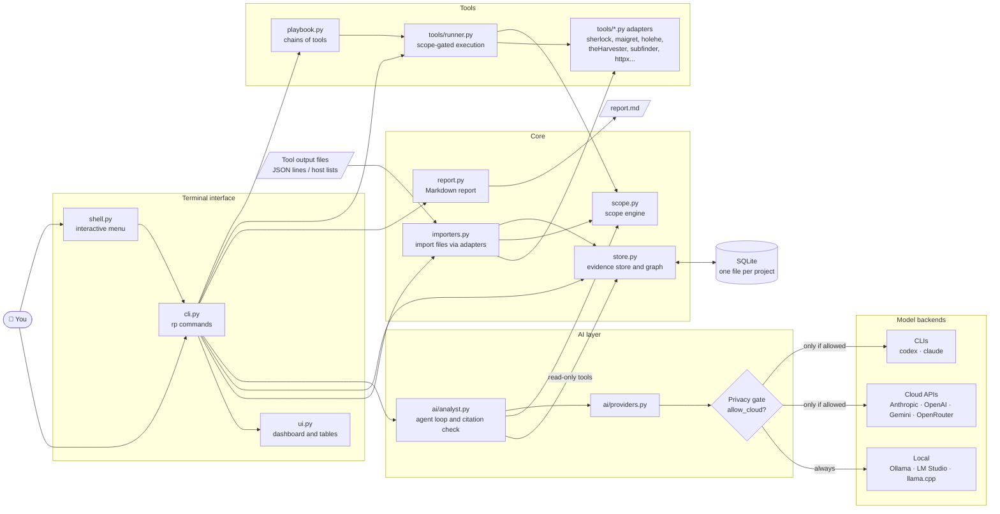
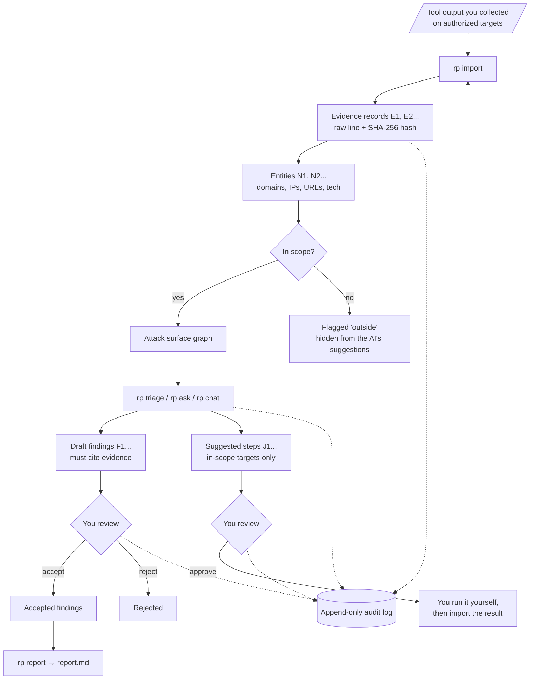
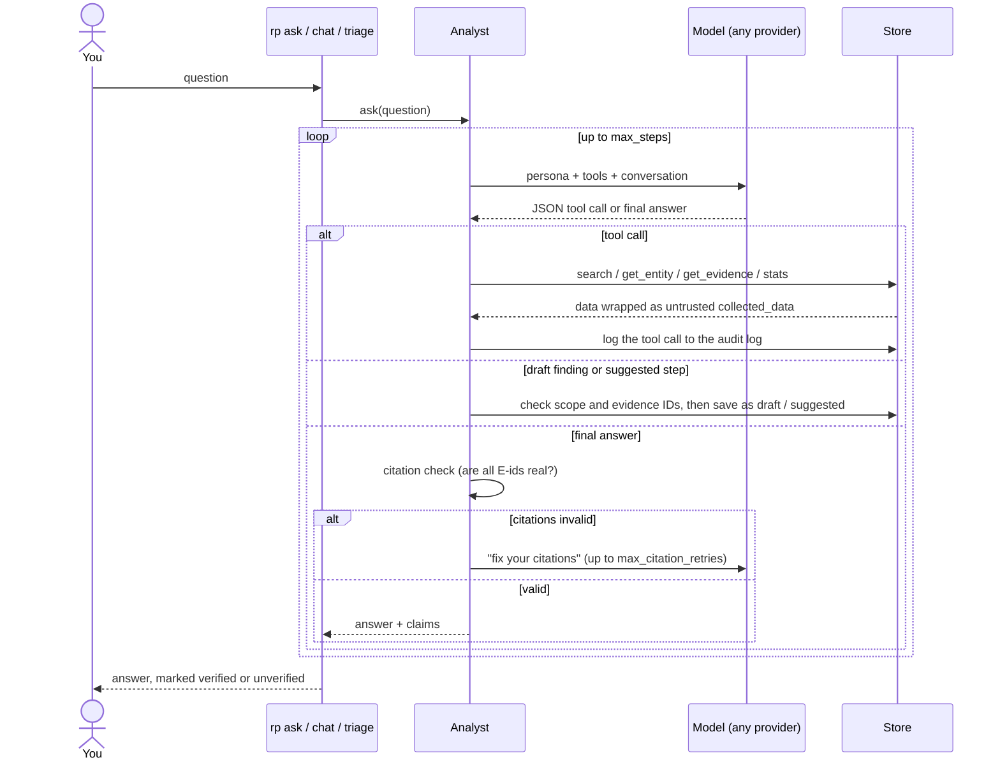
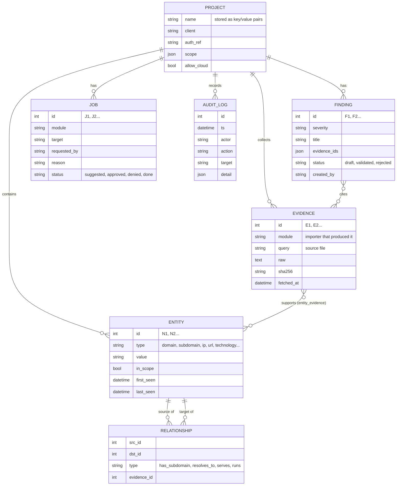

# ◆ ReconPilot

**A local-first OSINT workbench with an AI analyst that has to show its evidence.**

ReconPilot runs OSINT and recon tools (Sherlock, Maigret, holehe, theHarvester, subfinder, dnsx, httpx) against
targets you are **authorized** to investigate, or imports output you already have, and turns it into one
searchable graph of hosts, IPs, URLs, technologies, usernames, accounts and emails. Then an AI analyst
(your choice of model: local Qwen, Claude, Codex, GPT, Gemini...) triages the attack surface,
drafts findings and suggests next steps. Every claim it makes must cite a stored piece of evidence.

```text
╭──────────────────────────────── ◆ lab ────────────────────────────────╮
│  Client         Example Corp                                          │
│  Authorization  RoE-2026-001                                          │
│  In scope       example.com, 10.0.0.0/24                              │
│  Cloud AI       blocked (local only)                                  │
│                                                                       │
│  ╭─ domains ──╮ ╭─── IPs ────╮ ╭─── URLs ───╮ ╭─── tech ───╮          │
│  │     5      │ │     3      │ │     3      │ │     9      │          │
│  ╰────────────╯ ╰────────────╯ ╰────────────╯ ╰────────────╯          │
│                                                                       │
│   ID   Severity   Title                                   Status      │
│   F1   HIGH       Outdated Apache 2.4.49 on admin panel   draft       │
│                                                                       │
│  Next                                                                 │
│    rp triage          let the AI analyst review the attack surface    │
│    rp accept F1       review draft findings                           │
╰───────────────────────────────────────────────────────────────────────╯
```

## Why ReconPilot

- **Local-first.** Everything lives in one SQLite file per engagement on your machine.
- **Any model.** Local models through Ollama, LM Studio or llama.cpp; cloud APIs; or the Codex and
  Claude Code CLIs you already pay for. Pick per project or per question.
- **No hallucinated findings.** Answers and findings without valid evidence IDs are rejected and sent
  back to the model.
- **Scope is enforced.** No project without an authorization reference and a scope. Out-of-scope assets
  are flagged, and the AI cannot suggest steps against them.
- **Runs your tools, safely.** `rp run sherlock jdoe` checks scope, engagement window and tool tier,
  runs the tool without a shell, keeps its raw output, and imports the results. Playbooks chain tools.
- **People, not only hosts.** Seed usernames, emails, phones or names; accounts found from them stay in
  scope, everything else is kept as an out-of-scope lead.
- **Human in the loop.** The AI only reads data. It never runs anything; its suggestions wait for
  your approval (`rp approve J3`, then `rp run J3`).
- **Audit trail.** Every import, AI tool call and decision is logged in an append-only table.

## Architecture

### Components



### Data flow: from raw output to a report



### How a question to the AI analyst is answered



### Data model



The diagrams use [Mermaid](https://mermaid.js.org), which GitHub, GitLab and most Markdown editors render
automatically.

## Install

Requires Python 3.11+.

```bash
git clone <your-repo-url> reconpilot && cd reconpilot
uv venv && uv pip install -e .          # or: python -m venv .venv && .venv/bin/pip install -e .
source .venv/bin/activate
rp --help
```

Optional: `uv pip install -e '.[anthropic]'` for the Claude API provider, `'.[dev]'` for the tests.

## Quick start

Try it with the fictional sample data in `examples/` and `tests/fixtures/`:

```bash
rp doctor                     # what is installed and ready
rp new lab --client "Example Corp" --auth-ref "RoE-2026-001" \
   --scope example.com --scope 10.0.0.0/24 --exclude dev.example.com --seed username:jdoe_test
rp import examples/subfinder.json examples/httpx.json tests/fixtures/sherlock/jdoe_test.csv
rp status                     # dashboard
rp search admin               # find assets
rp search -t account          # accounts found for jdoe_test
rp show N3                    # an entity, its relationships and evidence
rp triage                     # AI review: draft findings + suggested steps
rp findings                   # review what the AI found
rp accept F1                  # accept a finding (or: rp reject F1)
rp report --format html       # writes lab-report.html
```

With the tools installed, collect data directly instead of importing:

```bash
rp run sherlock jdoe_test             # one tool
rp run username-sweep jdoe_test       # a playbook: sherlock, maigret, holehe, AI summary
```

Or just run **`rp`** with no arguments for the interactive menu (arrow keys, enter to select).

## Usage guide

The full guide is in **[docs/USAGE.md](docs/USAGE.md)**: installing the tools, person-focused
investigations, playbooks (and writing your own), scope and policy, the AI analyst, reports, exports,
scripting with `--json`, adding your own tool adapter, and troubleshooting.

## Commands

The active project is remembered, so you never type its name. Switch with `rp use <name>`,
or target another one for a single command with `-p <name>`.

| Command | Alias | What it does |
| --- | --- | --- |
| `rp` | `rp menu` | Interactive menu |
| `rp doctor` | | Check Python, config, data dir, tools and AI models, with fixes |
| `rp new [name]` | `init` | Create a project (asks for missing details) |
| `rp use <name>` | | Switch the active project |
| `rp ls` | `projects` | List projects (● marks the active one) |
| `rp status` | `st` | Dashboard: scope, counts, findings, pending steps, what to do next |
| `rp scope [show\|add\|remove\|window]` | | Show or change the scope; entities are re-flagged |
| `rp seed <type> <values...>` | | Add people to investigate: username, email, phone, person |
| `rp policy low-touch\|active on\|off` | | Allow or block tools by tier |
| `rp cloud on\|off` | | Allow or block cloud AI for the active project |
| `rp tools` | | Tools, whether they are installed, tier and target type |
| `rp playbooks` | | Available playbooks |
| `rp run <tool> <target>` | | Run a tool under the scope gate and import its results |
| `rp run <playbook> <target>` | | Run a chain of tools |
| `rp run J<id>` | | Run an approved AI-suggested step |
| `rp import <files...>` | `i` | Import tool output; the tool is auto-detected |
| `rp search [text] [-t type]` | `s` | Search entities; `--out` for out-of-scope, `--all` for both |
| `rp show <N\|E\|F id>` | | Details of an entity (N12), evidence (E12) or finding (F3) |
| `rp triage [--identity] [-m model]` | | AI reviews the whole attack surface or identity footprint |
| `rp ask "question" [-m model]` | | One question to the AI analyst |
| `rp chat [-m model]` | | Conversation with the AI analyst (`/exit`, `/status`) |
| `rp findings` | `f` | List findings |
| `rp accept / reject <F ids...>` | | Review draft findings |
| `rp steps` | `jobs` | Next steps suggested by the AI |
| `rp approve / deny / done <J ids...>` | | Review suggested steps |
| `rp report [--format md\|html] [--drafts]` | | Report of accepted findings |
| `rp export [--format json\|csv\|graphml]` | | Export entities and relationships |
| `rp log` | `audit` | Audit log |
| `rp models` | | Model backends and whether they are ready |

`status`, `search`, `show`, `findings`, `steps`, `tools` and `scope show` accept `--json`.

## Supported tools

Each record a tool outputs becomes one evidence record (`E<n>`) that the AI can cite. Re-importing the
same file never duplicates evidence.

| Tool | Finds | `rp run` | Import file |
| --- | --- | --- | --- |
| sherlock | accounts for a username | yes (passive) | `<username>.csv` (`--csv`) |
| maigret | accounts + profile data | yes (passive) | `report_<username>_ndjson.json` (`--json ndjson`) |
| holehe | sites an email is registered on | yes (low-touch) | `holehe_<ts>_<email>_results.csv` (`-C`) |
| theHarvester | emails, hosts, IPs | yes (passive) | `-f` JSON |
| subfinder | subdomains | yes (passive) | JSON lines (`-oJ`) |
| dnsx | DNS records | yes (passive) | JSON lines (`-json`) |
| httpx | web services, technologies | yes (low-touch) | JSON lines (`-json`) |
| amass | subdomains | import only | v3 `enum -json` |
| anything else | | | a plain text list of hosts, one per line |

Force a format with `rp import file --format <tool>` if detection guesses wrong. To add a tool, write a
small adapter class; see [docs/USAGE.md](docs/USAGE.md#13-add-your-own-tool).

## Choosing an AI model

A model is written as `provider:model`. Check what is ready with `rp models`.

| Spec | Runs | Setup |
| --- | --- | --- |
| `ollama:qwen2.5:14b` | local | `ollama serve` and `ollama pull qwen2.5:14b` |
| `lmstudio:<model>` | local | Start the LM Studio server (port 1234) |
| `llamacpp:<model>` | local | `llama-server` on port 8080 |
| `anthropic:claude-opus-5-5` | cloud | `pip install anthropic`, set `ANTHROPIC_API_KEY` |
| `openai:<model>` | cloud | Set `OPENAI_API_KEY` |
| `gemini:<model>` | cloud | Set `GEMINI_API_KEY` |
| `openrouter:<model>` | cloud | Set `OPENROUTER_API_KEY` |
| `codex-cli:default` | cloud, via CLI | `codex` installed and logged in |
| `claude-cli:default` | cloud, via CLI | `claude` installed and logged in |

**Projects block cloud models by default.** Turn them on only if the client allows their data to leave
your machine: `rp cloud on`.

Use a model once with `-m`, or set defaults in `reconpilot.yaml`
(copy `reconpilot.example.yaml`):

```yaml
models:
  default: ollama:qwen2.5:14b
  profiles:
    triage: ollama:qwen2.5:14b         # rp triage
    analyst: anthropic:claude-opus-5-5 # rp ask / rp chat
```

Tip: local models under ~14B parameters struggle with multi-step tool use. Use 14B+ for the analyst.

## How the AI analyst works

1. It gets read-only tools: search assets, inspect an asset and its relationships, read evidence.
2. Collected text is wrapped as untrusted data, so instructions planted in a web page title or DNS record
   are not followed.
3. It can draft findings and suggest steps, but only with evidence IDs and only for in-scope targets.
4. Its final answer goes through a citation check. Missing or invented evidence IDs are sent back to the
   model to fix; answers that still fail are marked **unverified**.

## Project layout

```text
reconpilot/
  cli.py           commands            shell.py       interactive menu
  ui.py            terminal output     importers.py   file import via adapters
  scope.py         scope + subjects    store.py       SQLite evidence store, graph, migrations
  report.py        Markdown / HTML     export.py      JSON / CSV / GraphML
  playbook.py      playbook engine     playbooks/     built-in playbooks (YAML)
  tools/base.py    adapter interface   tools/runner.py  scope-gated tool execution
  tools/infra.py   subfinder, dnsx, httpx, amass, host lists
  tools/identity.py sherlock, maigret, holehe, theHarvester
  ai/providers.py  model backends      ai/analyst.py  agent loop and citation check
tests/             pytest suite        tests/fixtures/  real-format tool output samples
docs/USAGE.md      full usage guide    examples/      fictional sample data
```

## Development

```bash
uv pip install -e '.[dev]'
ruff check reconpilot tests
mypy reconpilot
pytest
```

## Roadmap

- [x] Scope engine, evidence store, importers, AI analyst, CLI and interactive menu
- [x] Tool adapters and scope-gated runner (`rp run`), `rp tools`, `rp doctor`, plugin entry point
- [x] Identity OSINT: subjects in scope, Sherlock, Maigret, holehe, theHarvester, playbooks
- [x] Evidence dedupe, schema migrations, scope editing with re-flagging, engagement window enforced
- [x] `--json` output, JSON / CSV / GraphML export, HTML report, CI (ruff, mypy, pytest)
- [ ] More adapters: Blackbird, PhoneInfoga, h8mail, exiftool, gau
- [ ] PyPI release and a Docker image with the tools preinstalled
- [ ] `rp diff` (what is new since the last run), `rp setup` wizard, shell completion
- [ ] Local web UI with an interactive graph view
- [ ] Evaluation set to compare models on real engagements

## Legal

Use ReconPilot only on assets you own or are explicitly authorized to assess. You are responsible for
complying with the law, your rules of engagement and each data source's terms of service.
